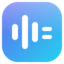

# 🎙️ Transcripables

<p align="center">
  
</p>

Language: [Indonesia](README.md) | English

**Chrome extension for Google Meet transcription, web meeting recording (Teams, Webex, Slack, Discord, Zoom), and automatic Minutes of Meeting (MoM)**

---

**Transcripables** is a Google Chrome extension that lives in the Google Meet side panel. It captures live captions during a meeting and summarizes them into Minutes of Meeting (MoM). Audio recordings are transcribed after recording stops (in *Rekam audio* mode) or whenever you press **Generate transkrip**.

Besides Google Meet, you can also record **Microsoft Teams web**, the **Webex web app**, **Slack huddles in the browser**, **Discord voice calls in the browser** (`discord.com/channels/…`), and **Zoom meetings in the web client** (`zoom.us/wc/…`). On those platforms the extension does not read captions: the recording is stored as an archive, a transcript is created through STT only when you press **Generate transkrip** in history (*Riwayat*), there are no speaker names, and you stop recording manually.

All meeting data is stored locally in your browser. There is no middle server, and you control the STT (speech-to-text) and LLM endpoints used, including a Whisper server on your own network. See [Security & Privacy](#-security--privacy) for exactly what data leaves your browser in each mode.

The extension's interface is in Indonesian, so UI labels below appear in their original wording, with English meanings where useful.

## ✨ Key Features

* **Quick Action Popup:** Clicking the extension icon opens a compact popup with **Rekam** (record: audio / audio + video), **Mikrofon** (microphone on/off), **Bahasa caption** (caption language: Indonesia / English), **Tampilkan detail** (show details, opens the side panel), and **Riwayat meet** (meeting history), which opens the selected meeting directly on its detail page.
* **Multiple Transcript Sources:** With **Sumber transkrip** (transcript source) set to *Rekam audio*, Google Meet's built-in captions (with speaker names) and tab audio recording (through STT) are combined into one meeting timeline, sorted by time.
* **Optional Video Recording:** Record the Meet tab as one `.webm` file (720p, VP9, about 250 MB/hour) from the **Rekam audio + video meeting** right-click menu. In *Caption Meet* mode this recording is only an archive: the transcript still comes from captions, and its audio is not sent to STT unless you press **Generate transkrip**.
* **Optional Microphone Recording:** By default, only other participants' voices (tab audio) are recorded. Turn on **Mikrofon** in the icon popup, or check **Rekam mikrofon** in Settings (both control the same setting), to mix your voice into audio and video recordings. Microphone permission is requested once through a small window. You can turn it on **during a recording**: the mic joins without interrupting the recording, and the earlier part stays without mic. You cannot turn it off mid-recording; stop the recording first.
* **Your Own STT Endpoint:** Point it at a private Whisper server (whisper.cpp, faster-whisper) on your own network, or at any OpenAI-compatible STT API.
* **Automatic MoM:** Generates context, discussion, participants, and action items using an OpenAI-compatible LLM endpoint (for example `gpt-4o-mini`). The template is customizable.
* **No API Key Option:** Copy the prompt and transcript to your clipboard, or automatically send them to Google Gemini or ChatGPT in a new tab without an API integration.
* **Local History:** Transcripts, MoM, and settings are stored in `chrome.storage.local`; audio chunks are stored in IndexedDB. Export history to `.txt` or `.md` at any time.
* **Backup & Restore:** The **Export backup (.zip)** button in Settings saves text data (history, MoM, settings) to one ZIP file, **not** recording files: audio and video are excluded because they can reach hundreds of MB per recording, so download them yourself from a history entry with **Unduh** (download). **Import backup** restores that text data, including after uninstalling or moving to another computer, and **deletes recordings stored at that time**.
* **Recurring Meeting Awareness:** Recurring meetings use the same link (room code), but each session remains a separate history entry. A gap of more than 30 minutes after a meeting ends counts as a new session; leaving and rejoining briefly stays in the same session.
* **Smart Audio Recovery:** Audio chunks are saved to IndexedDB during recording. If STT is misconfigured, use **Transkrip ulang** (re-transcribe) without losing audio.
* **Manual Audio Transcription:** Recordings that were not transcribed automatically (Meet in *Caption Meet* mode, Teams, Webex, Slack, Discord, Zoom) show a **Generate transkrip** button in history while their audio is still stored. Without stored audio, the button does not appear.
* **Automatic Lifecycle (Google Meet):** Recording stops automatically when a meeting ends (leaving the call, switching rooms, or closing the recorded tab). Closing another tab that joined the same room does not stop the recording.
* **Hidden Captions (Default):** Captions are hidden from the Meet screen without turning CC off, so video tiles stay full size while the transcript keeps filling the panel. To see captions again, turn off **Sembunyikan caption di layar Meet** (hide captions on the Meet screen) in Settings.
* **Caption Language from the Popup:** Meet's language selector sits inside the caption area, so it gets hidden too. Choosing **Indonesia** (default) or **English** in the popup applies it directly to Meet, once per call. Manual changes in Meet's UI are respected.
* **Discord Web Recording:** Voice calls at `discord.com/channels/…` can be recorded (audio, or audio + tab video). Web version only: the Discord desktop app is out of the extension's reach.
* **Zoom Web Recording:** Meetings in the Zoom web client (`zoom.us/wc/<id>/join`, `/start`, or the older `/wc/join/<id>`) can be recorded, including `app.zoom.us` and company vanity subdomains. Start from the **icon popup** or the `Alt+Shift+R` / `Alt+Shift+V` shortcuts; the right-click menu is not registered for Zoom. `zoom.us/j/<id>` links are not web client pages: they launch the desktop app, whose audio is not in the tab. Zoom for Government (`zoomgov.com`) is out of scope.
* **Teams, Webex, and Slack Web Recording:** Start from the **icon popup** or the `Alt+Shift+R` / `Alt+Shift+V` shortcuts (the right-click menu is not registered). The tab URL must contain a meeting id:
  * **Teams** (`teams.microsoft.com`, `teams.live.com`, `teams.cloud.microsoft`): thread id `19:meeting_…@thread.v2` (in the web client hash, an `/l/meetup-join/…` invite link, or the launcher) or a short `/meet/<number>` link. One meeting opened through both link types becomes two history entries.
  * **Webex** (`<site>.webex.com`): `MTID=m<hex>` in an invite link, a hex id on the *join* page, or a personal room at `/meet/<name>` / `/join/<name>`. `web.webex.com` (the Webex app in the browser) is not recognized yet.
  * **Slack** (`app.slack.com`): the huddle window at `/huddle/<workspace>/<channel>` or the channel view at `/client/<workspace>/<channel>`. Huddles have no id of their own, so one channel/DM is one entry, as with Discord.
  * The URL shapes of these three platforms **while already in a call** have not been verified with real meetings. If the Record button refuses, its message shows the tab URL; send that URL so its shape can be added.

---

## 🚀 Installation Guide

The extension runs on **Chrome 116+**, including other Chromium browsers (Edge, Brave, Opera, Vivaldi), and **Firefox 128+**. On Chromium it is installed through *Developer* mode; on Firefox, directly from the [official Firefox Add-ons page](https://addons.mozilla.org/en-US/firefox/addon/meet-transcript/). **The Firefox version is caption-only**: no audio recording or STT, because Firefox has no `tabCapture` API. (The side panel has existed since Chrome 114, but restoring recording state uses `chrome.runtime.getContexts`, which arrived in 116.) No build process or Chrome Web Store install is required.

### Method 1: Release ZIP (Recommended)

1. Open the **[Releases](../../releases)** page and download the latest `transcripables-vX.Y.Z.zip` asset. *(This package is clean: extension files only, no docs or tests, under 1 MB.)*
2. Extract the ZIP to a permanent folder on your computer (avoid *Downloads*).
3. Open `chrome://extensions` in Google Chrome (Edge: `edge://extensions`, Brave: `brave://extensions`, Opera: `opera://extensions`).
4. Turn on **Developer mode** (switch at the top right).
5. Click **Load unpacked**, then select the **`transcripables`** folder inside the extracted files: the folder that directly contains `manifest.json`, not its wrapper folder.
6. Pin the Transcripables icon to your toolbar.

> **To update:** Download the latest ZIP, replace the files in the old folder, then click the **Reload** icon (🔄) on the extension's card.

### Method 2: Git Clone (For Developers)

```bash
git clone https://github.com/dimasekaadinandra25/transcripables.git
```

Open `chrome://extensions`, choose **Load unpacked**, and select the cloned folder. To update, run `git pull`, then click **Reload**.

> [!NOTE]
> The "Disable developer mode extensions" warning shown when Chrome starts is normal for extensions outside the Web Store. You can ignore it. Do not click "Remove".

### Firefox

Install directly from Mozilla's official Add-ons site: **[Transcripables on Firefox Add-ons](https://addons.mozilla.org/en-US/firefox/addon/meet-transcript/)** (the listing may still show the old name, Meet Transcript), then click **Add to Firefox**. Updates are automatic. After installing, click the Transcripables toolbar icon to open or close the sidebar.

> [!NOTE]
> The Firefox version is **caption-only**: the Audio Recording & STT Modes features below are unavailable (Firefox has no `tabCapture` API). Caption transcripts, history, MoM, and sending to Gemini/ChatGPT work fully.
>
> For development: copy the repo folder, replace `manifest.json` in that copy with the contents of `manifest.firefox.json`, then load it through `about:debugging`, *This Firefox*, *Load Temporary Add-on* (it disappears when Firefox closes).

---

## 🖥️ Desktop App (Windows)

The desktop app records your computer's audio and your microphone, so it works with any meeting app that plays through your speakers or headset, including Zoom, Teams, Slack, Webex, Discord, and WhatsApp desktop. It produces a transcript labeled **You** and **Others**, MoM, and one recording file per meeting. It has no speaker names beyond those two labels. macOS support comes later.

### Install

1. Run `Transcripables-Setup-X.Y.Z.exe`.
2. Windows SmartScreen warns about the unsigned installer. Choose **More info**, then **Run anyway**.
3. Open **Settings** and fill in your STT and LLM endpoints.

To build the installer yourself: `npm --prefix desktop install`, then `npm --prefix desktop run dist`. It is saved in `desktop/dist/`.

### Use

| Action | Control | Shortcut |
| --- | --- | --- |
| Record audio | **Rekam audio** | `Alt+Shift+A` |
| Record audio + video | **Rekam audio + video** | `Alt+Shift+V` |
| Stop | **Stop rekam** | `Alt+Shift+S` |
| Mute or unmute your microphone | **Bisukan mikrofon** | `Alt+Shift+M` |

* Muting in Zoom or Teams does **not** stop this app's microphone recording. Use the app's own mute.
* Closing the window while recording keeps recording in the system tray. The tray icon and window title show when it is recording.
* Everything on your computer's speakers gets recorded, including notifications and other apps.
* Without a headset, other people's voices can leak into your microphone and appear twice, labeled **You**.
* Ask meeting participants for permission before recording.

### Limits

* If the app crashes, the recording file can lose about the last minute, and the transcript can lose up to the last 10 minutes.
* API keys are encrypted on your computer, but **Export backup** stores them in plain text.

---

## 📖 Quick Start

1. **Start a meeting:** Join Google Meet. The extension tries to turn on Closed Captions (CC) automatically. Captions are **not shown on screen** (hidden by default), so check the **Live** tab in the panel to confirm the transcript is arriving. If it is empty, look at the CC button in Meet's toolbar: a highlighted icon means it is on; if not, click it once.
2. **Open the panel:** Click the extension icon, then **Tampilkan detail** in the popup to open the side panel (Firefox: clicking the icon opens the sidebar directly). The **Live** tab starts filling automatically.
3. **Record audio/video (optional):** Click the extension icon, then **Rekam**, then *Audio saja* (audio only) or *Audio + video*. You can also use the right-click menu or the `Alt+Shift+R` / `Alt+Shift+V` shortcuts.
4. **Generate MoM:** After the meeting, open the **Riwayat** tab, choose the meeting, open the **Generate MoM** dropdown, then choose **Generate MoM** (or **Kirim ke Gemini** / **Kirim ke ChatGPT**, meaning send to Gemini or ChatGPT, without an API key). The **Copy** dropdown contains *Copy transkrip* / *Copy Prompt+Transkrip*; the **Unduh** dropdown contains *.txt*, *.md*, and audio/video recordings when available.

**Initial setup (Settings):**
Before first use, fill in *Settings*: enter your LLM API key, choose a model, and adjust the MoM template (it must contain the `{{transcript}}` variable; saving warns you if it is missing). The **Mode STT** block is used for audio transcripts, both automatic (Meet in *Rekam audio* mode) and through **Generate transkrip** (Chrome/Chromium only; this block does not exist on Firefox). **Tes koneksi** (test connection) tests the LLM endpoint, plus the STT endpoint when **Sumber transkrip** is *Rekam audio*. Permission to access the STT address is requested when saving in *Rekam audio* mode, or when first pressing **Generate transkrip** in other modes.

---

## 🎙️ Audio Recording & STT Modes (Chrome/Chromium Only)

You can record tab audio and transcribe it through STT, either alone or together with Meet's built-in captions. Features in this section are unavailable on Firefox.

### How to Record Audio

1. Open **Settings** and configure **Mode STT**. Automatic transcription on Stop only runs for Google Meet with **Sumber transkrip** set to *Rekam audio*. Other recordings (Meet in *Caption Meet* mode, Teams, Webex, Slack, Discord, and Zoom) are stored as audio/video archives; open the entry in **Riwayat** and click **Generate transkrip** if you need a transcript of its audio (the button only appears while its audio is stored).
2. During a call, start recording through one of three paths: the **extension icon popup** then *Rekam*, **right-click** on the page, or a keyboard shortcut. *Audio + video* also records the tab's picture (720p VP9, about 250 MB/hour, downloaded as one `.webm` file with **Unduh video** in history).
3. On Google Meet, recording stops automatically when you leave the call. **On Teams, Webex, Slack, Discord, and Zoom it does not**: there is no session tracking there, so stop it yourself through the popup, panel, the `Alt+Shift+S` shortcut, or right-click then **Stop rekam** (Meet/Discord only). After stopping, **Menyimpan rekaman…** (saving recording, for archives) or **Mentranskrip…** (transcribing, for automatic transcripts) appears until processing finishes.

**Important notes:**

* Because of Chrome's security limits, `tabCapture` requires a per-tab permission granted only by invoking the extension: clicking the icon (popup), clicking a context menu item, or using a keyboard shortcut. Buttons in the side panel or injected into the page **do not** qualify, and Chrome rejects them with *"Extension has not been invoked for the current page"*. That is why the **Rekam** button lives in the popup, not the panel; the panel only has **Stop rekam**.
* Default shortcuts: `Alt+Shift+R` (audio), `Alt+Shift+V` (audio + video), `Alt+Shift+S` (stop). Change them at `chrome://extensions/shortcuts`. They are useful on Discord, which swallows the `contextmenu` event so the browser's right-click menu does not appear (`Shift` + right-click forces it to appear).
* By default, only other participants' voices (*tab audio*) are recorded. Check **Rekam mikrofon** in *Settings* to include your voice, then click **Izinkan mikrofon** (allow microphone) once to grant permission. If you have not, a permission window appears automatically when recording starts; tab recording continues and the mic joins once approved. Without a headset, participants' voices from your speakers can also be picked up by the mic (doubled).
* Every 10 minutes, an audio chunk is saved to IndexedDB to avoid data loss if the browser closes unexpectedly. Chunks can be downloaded at any time with **Unduh audio** as separate `.webm` files (Chrome may need the *"Download multiple files"* permission when there is more than one).
* Only the **last 5 recordings** are kept. When a new recording starts, the oldest beyond those five is deleted, both audio and video.

### STT Mode Options (Speech-to-Text)

| Mode (UI label) | Requirements | Audio is sent to | Description |
| --- | --- | --- | --- |
| **Whisper lokal (server sendiri)** | OpenAI-compatible Whisper server | The URL **you** enter | **[Default]** Pre-filled with `http://localhost:8080/v1` |
| **STT API** | URL + API key (**required**) | 🌐 That endpoint | Fastest. Offers STT model and language options. |

> [!WARNING]
> In **STT API** mode, if **STT Base URL** is left empty, the extension falls back to your LLM *Base URL* and uses your **LLM API key**, so meeting audio is sent to the chat endpoint (default `https://api.openai.com/v1`). Fill in STT Base URL explicitly.

---

## 🔒 Security & Privacy

This extension is designed to be *privacy-first*:

* **Local storage:** Your API key is stored only in `chrome.storage.local` on your device and is never committed to the repository. The extension has no telemetry or analytics.
* **Local Whisper:** Audio is sent to the URL **you** enter in *STT Base URL* (default `http://localhost:8080/v1`). The extension **does not** force that URL to actually be local, so make sure it really is your server. If an *STT API key* was ever entered, it is still sent as the `Authorization` header even though the field is hidden in this mode.
* **Endpoint transparency:** MoM is generated through the endpoint you choose. Make sure your configured endpoint fits your company's or team's data security policy.
* **Copy Prompt / Send to Gemini / Send to ChatGPT:** All three copy the **entire transcript** to the clipboard, and the Gemini/ChatGPT buttons paste it into `gemini.google.com` / `chatgpt.com`, which means the whole meeting's content goes into your Google/OpenAI account. Do not use them for meetings whose content must not leave.
* **Backup files:** The ZIP created by **Export backup** contains **your API key in plain text** along with all transcripts. Store the file safely and do not share it.

---

## 🛠️ Troubleshooting

* **Transcript does not appear even though Meet's CC button is on:** (Captions themselves do not show on screen because they are hidden by default; turn off **Sembunyikan caption di layar Meet** in Settings to confirm visually.) Google may have changed Meet's DOM structure. The extension shows a warning when captions are on but no text is read for 30 seconds. (Developers: update the selectors in `content/selectors.js`.)
* **Live tab points to an old meeting, or recording does not stop by itself:** Google Meet is a SPA: switching rooms and leaving a call only change the URL in the same document. Session tracking is handled by `content/session.js` (pure logic, tested in `test/session.test.mjs`). Meet rooms are recognized as `meet.google.com/<code>`, `/meet/<code>`, and `/_meet/<code>`.
* **Record button refuses with "Buka halaman ruang … dulu" (open the room page first):** The tab URL was not recognized as a meeting page. The message shows the tab URL; send that URL so its shape can be added (see the URL list under *Key Features*).
* **Audio transcript is empty or contains `[transkrip gagal]` (transcription failed):** The panel shows a summary of the cause, for example *"3/14 potongan gagal ditranskrip: HTTP 404 …"* (3 of 14 chunks failed). Check the endpoint URL or STT model in your settings, and make sure the address really is an STT server, not another service on the same port. After fixing it, click **Transkrip ulang** (or **Generate transkrip** for recordings never transcribed) on that meeting's history entry; the original audio is still stored.
* **Captions still show after the extension is reloaded:** Content scripts in already open tabs become orphaned when the extension reloads, and they intentionally remove their own caption-hiding style (otherwise captions stay locked hidden and out of reach of Settings). Reload the Meet tab.
* **Caption language does not change:** The extension tries at most 3 times per call, then stops. If Google changes the language selector's structure, fix `langCombobox()`/`langOption()` in `content/selectors.js`.
* **"Belum ada suara masuk" (no sound yet) warning:** Without **Rekam mikrofon**, the system only captures other participants' voices. If nobody else is talking, there is no audio to process.
* **Stop button disappears, or recording seems to stop by itself:** Already fixed. MV3 service workers die after about 30 idle seconds, and recording state used to live only in memory. Outside Meet no content script keeps it alive, so the UI returned to "not recording" while the recording kept going. State is now requested from the offscreen document whenever the service worker wakes. If the button still does not appear, `Alt+Shift+S` always works.
* **Error logs:** If an error occurs in the side panel, its message and stack trace can be selected and copied directly from the panel.

---

## 💻 Development

This project has no complex *build step* (no `npm install`) and uses optimized vanilla JavaScript (Manifest V3).

**Directory structure:**

* `background/`: Service worker, state management, storage, and lifecycle.
* `content/`: Meet DOM injection logic (`selectors.js`, `session.js`, `captions.js`, `captionhide.js`, `captionlang.js`). **All** Meet DOM selectors live in `selectors.js`, including language label patterns.
* `panel/`: User interface (*Live*, *Riwayat*, *Settings*).
* `popup/`: Toolbar icon popup (Rekam, Bahasa caption, Riwayat), the only UI surface allowed to start `tabCapture`.
* `offscreen/`: Tab audio/video recording and STT orchestration (the MV3 service worker can die during long uploads).
* `lib/`: Core utilities (`openai.js`, `stt.js`, `audiostore.js`/IndexedDB, `merge.js`, `ui.js`, the DOM helper shared by panel and popup).
* `manifest.firefox.json`: Manifest for the Firefox build (`sidebar_action`, *event page*, no `tabCapture`/`offscreen`). Its version must match `manifest.json`.
* `test/` · `scripts/` · `icons/` · `docs/`: Node tests, release script, icons, and internal design notes.

**Running tests:**

```bash
node --test test/*.test.mjs
```

**Creating a release (maintainers only):**

Requires `node` (the script reads the version from `manifest.json`) and a logged-in `gh` CLI.

1. Update `"version"` in `manifest.json` **and** `manifest.firefox.json` (the script refuses to run if they differ).
2. Commit and `git push`.
3. Run the release script:

```bash
./scripts/pack.sh --release
```

*(The script builds the Chrome ZIP and publishes it to GitHub Releases; that ZIP is for Chrome/Chromium only. Firefox releases are separate and have no GitHub ZIP: run `./scripts/pack.sh --firefox` to build `dist/transcripables-firefox-vX.Y.Z.zip` (checked by `web-ext lint` first), then upload it as a new version in the [AMO Developer Hub](https://addons.mozilla.org/developers/). Firefox users get automatic updates from the [add-on page](https://addons.mozilla.org/en-US/firefox/addon/meet-transcript/).)*

---

## 📄 License

[MIT](LICENSE) © zenmz. Based on Meet Transcript by zenmz.
