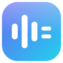

# 🎙️ Transcripables

<p align="center">
  
</p>

Language: English | [Indonesia](README.id.md)

**Chrome extension for Google Meet transcription, web meeting recording (Teams, Webex, Slack, Discord, Zoom), and automatic Minutes of Meeting (MoM)**

---

**Transcripables** is a Google Chrome extension that lives in the Google Meet side panel. It captures live captions during a meeting and summarizes them into Minutes of Meeting (MoM). Audio recordings are transcribed after recording stops (in *Record audio* mode) or whenever you press **Generate transcript**.

Besides Google Meet, you can also record **Microsoft Teams web**, the **Webex web app**, **Slack huddles in the browser**, **Discord voice calls in the browser** (`discord.com/channels/…`), and **Zoom meetings in the web client** (`zoom.us/wc/…`). On those platforms the extension does not read captions: the recording is stored as an archive, a transcript is created through STT only when you press **Generate transcript** in **History**, there are no speaker names, and recording stops when you press Stop or close the recorded tab.

All meeting data is stored locally in your browser. There is no middle server, and you control the STT (speech-to-text) and LLM endpoints used, including a Whisper server on your own network. See [Security & Privacy](#-security--privacy) for exactly what data leaves your browser in each mode.

The extension's interface is in Indonesian, so UI labels below appear in their original wording, with English meanings where useful.

## ✨ Key Features

* **Quick Action Popup:** Clicking the extension icon opens a compact popup with **Record** (record: audio / audio + video), **Microphone** (microphone on/off), **Caption language** (caption language: English / Indonesia), **Show details** (show details, opens the side panel), and **History** (meeting history), which opens the selected meeting directly on its detail page.
* **Multiple Transcript Sources:** With **Transcript source** (transcript source) set to *Meet captions + recorded audio*, Google Meet's built-in captions (with speaker names) and tab audio recording (through STT) are combined into one meeting timeline, sorted by time.
* **Optional Video Recording:** Record the Meet tab as one `.webm` file (720p, VP9, about 250 MB/hour) from the **Record meeting audio + video** right-click menu. In *Meet captions* mode this recording is only an archive: the transcript still comes from captions, and its audio is not sent to STT unless you press **Generate transcript**.
* **Optional Microphone Recording:** By default, only other participants' voices (tab audio) are recorded. Turn on **Microphone** in the icon popup, or check **Record microphone** in Settings (both control the same setting), to mix your voice into audio and video recordings. Microphone permission is requested once through a small window. You can turn it on **during a recording**: the mic joins without interrupting the recording, and the earlier part stays without mic. You cannot turn it off mid-recording; stop the recording first.
* **Your Own STT Endpoint:** Point it at a private Whisper server (whisper.cpp, faster-whisper) on your own network, or at any OpenAI-compatible Online speech-to-text service.
* **Automatic MoM:** Generates context, discussion, participants, and action items using an OpenAI-compatible LLM endpoint (for example `gpt-4o-mini`). The template is customizable.
* **No API Key Option:** Copy the prompt and transcript to your clipboard, or automatically send them to Google Gemini or ChatGPT in a new tab without an API integration.
* **Local History:** Transcripts, MoM, and settings are stored in `chrome.storage.local`; audio chunks are stored in IndexedDB. Export history to `.txt` or `.md` at any time.
* **Backup & Restore:** The **Export backup (.zip)** button in Settings saves text data (history, MoM, settings) to one ZIP file, **not** recording files: audio and video are excluded because they can reach hundreds of MB per recording, so download them yourself from a history entry with **Download** (download). **Import backup** restores that text data, including after uninstalling or moving to another computer, and **deletes recordings stored at that time**.
* **Recurring Meeting Awareness:** Recurring meetings use the same link (room code), but each session remains a separate history entry. A gap of more than 30 minutes after a meeting ends counts as a new session; leaving and rejoining briefly stays in the same session.
* **Smart Audio Recovery:** Audio chunks are saved to IndexedDB during recording. If STT is misconfigured, use **Retranscribe** (re-transcribe) without losing audio.
* **Manual Audio Transcription:** Recordings that were not transcribed automatically (Meet in *Meet captions* mode, Teams, Webex, Slack, Discord, Zoom) show a **Generate transcript** button in history while their audio is still stored. Without stored audio, the button does not appear. The audio is compared with nearby captions. A caption that was clearly the same sentence but misheard takes the audio's words and keeps its speaker name. Audio lines that repeat a caption are left out. If nothing changes, the panel says so and the transcript stays as it was.
* **Automatic Lifecycle (Google Meet):** Recording stops automatically when a meeting ends (leaving the call, switching rooms, or closing the recorded tab). Closing another tab that joined the same room does not stop the recording.
* **Hidden Captions (Default):** Captions are hidden from the Meet screen without turning CC off, so video tiles stay full size while the transcript keeps filling the panel. To see captions again, turn off **Hide captions on the Meet screen** (hide captions on the Meet screen) in Settings.
* **Caption Language from the Popup:** Meet's language selector sits inside the caption area, so it gets hidden too. Choosing **English** (default) or **Indonesia** in the popup applies it directly to Meet, once per call. Manual changes in Meet's UI are respected.
* **Discord Web Recording:** Voice calls at `discord.com/channels/…` can be recorded (audio, or audio + tab video). Web version only: the Discord desktop app is out of the extension's reach.
* **Zoom Web Recording:** Meetings in the Zoom web client (`zoom.us/wc/<id>/join`, `/start`, or the older `/wc/join/<id>`) can be recorded, including `app.zoom.us` and company vanity subdomains. Start from the **icon popup**, the right-click menu, or the `Alt+Shift+R` / `Alt+Shift+V` shortcuts. `zoom.us/j/<id>` links are not web client pages: they launch the desktop app, whose audio is not in the tab. Zoom for Government (`zoomgov.com`) is out of scope.
* **Teams, Webex, and Slack Web Recording:** Start from the **icon popup**, the right-click menu, or the `Alt+Shift+R` / `Alt+Shift+V` shortcuts. The tab URL must contain a meeting id:
  * **Teams** (`teams.microsoft.com`, `teams.live.com`, `teams.cloud.microsoft`): thread id `19:meeting_…@thread.v2` (in the web client hash, an `/l/meetup-join/…` invite link, or the launcher) or a short `/meet/<number>` link. One meeting opened through both link types becomes two history entries.
  * **Webex** (`<site>.webex.com`): `MTID=m<hex>` in an invite link, a hex id on the *join* page, or a personal room at `/meet/<name>` / `/join/<name>`. `web.webex.com` (the Webex app in the browser) is not recognized yet.
  * **Slack** (`app.slack.com`): the huddle window at `/huddle/<workspace>/<channel>` or the channel view at `/client/<workspace>/<channel>`. Huddles have no id of their own, so one channel/DM is one entry, as with Discord.
  * The URL shapes of these three platforms **while already in a call** have not been verified with real meetings. If the Record button refuses, its message shows the tab URL; send that URL so its shape can be added.

---

## 🚀 Installation Guide

The extension runs on **Chrome 116+**, including other Chromium browsers (Edge, Brave, Opera, Vivaldi), and **Firefox 128+**. On Chromium it is installed through *Developer* mode; on Firefox, directly from the [official Firefox Add-ons page](https://addons.mozilla.org/en-US/firefox/addon/meet-transcript/). **The Firefox version is caption-only**: no audio recording or STT, because Firefox has no `tabCapture` API. (The side panel has existed since Chrome 114, but restoring recording state uses `chrome.runtime.getContexts`, which arrived in 116.) No build process or Chrome Web Store install is required.

### Method 1: Release ZIP (Recommended)

1. Open the **[Releases](../../releases)** page and download the latest `transcripables-vX.Y.Z.zip` asset. *(This package is clean: extension files only, no docs or tests, under 1 MB.)*
2. Extract the ZIP to a permanent folder on your computer (avoid *Downloads*).
3. Open `chrome://extensions` in Google Chrome (Edge: `edge://extensions`, Brave: `brave://extensions`, Opera: `opera://extensions`).
4. Turn on **Developer mode** (switch at the top right).
5. Click **Load unpacked**, then select the **`transcripables`** folder inside the extracted files: the folder that directly contains `manifest.json`, not its wrapper folder.
6. Pin the Transcripables icon to your toolbar.

> **To update:** Download the latest ZIP, replace the files in the old folder, then click the **Reload** icon (🔄) on the extension's card.

### Method 2: Git Clone (For Developers)

```bash
git clone https://github.com/dimasekaadinandra25/meet-transcript.git
```

Open `chrome://extensions`, choose **Load unpacked**, and select the cloned folder. To update, run `git pull`, then click **Reload**.

> [!NOTE]
> The "Disable developer mode extensions" warning shown when Chrome starts is normal for extensions outside the Web Store. You can ignore it. Do not click "Remove".

### Firefox

Install directly from Mozilla's official Add-ons site: **[Transcripables on Firefox Add-ons](https://addons.mozilla.org/en-US/firefox/addon/meet-transcript/)** (the listing may still show the old name, Meet Transcript), then click **Add to Firefox**. Updates are automatic. After installing, click the Transcripables toolbar icon to open or close the sidebar.

> [!NOTE]
> The Firefox version is **caption-only**: the Audio Recording & STT Modes features below are unavailable (Firefox has no `tabCapture` API). Caption transcripts, history, MoM, and sending to Gemini/ChatGPT work fully.
>
> For development: copy the repo folder, replace `manifest.json` in that copy with the contents of `manifest.firefox.json`, then load it through `about:debugging`, *This Firefox*, *Load Temporary Add-on* (it disappears when Firefox closes).

---

## 🖥️ Desktop App (Windows)

The desktop app records your computer's audio and your microphone, so it works with any meeting app that plays through your speakers or headset, including Zoom, Teams, Slack, Webex, Discord, and WhatsApp desktop. It produces a transcript labeled **You** and **Others**, MoM, and one recording file per meeting. After each recording or imported file is transcribed, the app tells the other voices apart on your computer, so **Others** becomes **Speaker 1**, **Speaker 2**, and so on. It is free, needs no account, and the audio stays on your computer. It adds a few minutes for a long meeting, and **Tell other speakers apart** in **Settings** turns it off. It can merge people with similar voices or split one person in two, so these labels are marked **guessed**; check them before you rename them. During the meeting, labels appear on the live transcript a little behind the newest lines, which say **Others** until the next pass, and the final labels come when you stop. If your STT service returns its own speakers (**Speaker A**, **Speaker B**), those are kept instead. macOS is less tested: automated tests build and open it and run its speech engine, but nobody has recorded with it on a real Mac.

### Install

1. Run `Transcripables-Setup-X.Y.Z.exe`.
2. Windows SmartScreen warns about the unsigned installer. Choose **More info**, then **Run anyway**.

**On a Mac:** download the `.dmg` for your chip (`arm64` for Apple Silicon, `x64` for Intel). Because it is unsigned, macOS blocks the first open: go to **System Settings > Privacy & Security** and choose **Open Anyway**. If macOS says the app is damaged, run `xattr -cr /Applications/Transcripables.app`. Allow the microphone and screen recording when asked. Recording computer sound needs macOS 14.2 or later. Electron documents it, but nobody has tried it on a real Mac yet, so test it before relying on it. If no computer sound arrives, the app warns you after 1 minute.

3. Open **Settings** and fill in your LLM endpoint for MoM. Speech-to-text uses the built-in engine by default, so it needs no server or internet.

To build the installer yourself: `npm --prefix desktop install`, then `npm --prefix desktop run dist`. It downloads the speech engine, checks its SHA-256, compiles the per-app sound helper with `g++`, and saves the installer in `desktop/dist/`. On a Mac, use `dist:mac`, which compiles the speech engine and needs `cmake` and Xcode command line tools.

**Code signing:** the installers are unsigned for now. See *Creating a release* below for how to add a certificate.

### Use

| Action | Control | Shortcut |
| --- | --- | --- |
| Record audio | **Record audio** | `Alt+Shift+A` |
| Record audio + video | **Record audio + video** | `Alt+Shift+V` |
| Stop | **Stop recording** | `Alt+Shift+S` |
| Mute or unmute your microphone | **Mute microphone** | `Alt+Shift+M` |
| Pause or resume | **Pause recording** | `Alt+Shift+P` |
| Mark an important moment | **Mark moment** | `Alt+Shift+K` |

* **Language** in Settings switches the app between English and Bahasa Indonesia. Transcripts, MoM, and titles are never translated, and `Alt` shortcut letters stay the same in both languages.
* **Import audio file** turns an existing audio or video file into a meeting with a transcript. A speech-quality copy is kept with your recordings, so ▶ and **Retranscribe** work. It counts toward **Recordings to keep** in Settings.
* Right-click the tray icon to record, stop, mute, or open the recordings folder without opening the window.
* **Check for updates** in Settings looks for a new GitHub release and opens its download page. It does not install anything by itself.
* Every button also has an `Alt` shortcut that works while the window is focused. Hold `Alt` to see them, or hover a button.
* `Ctrl+K` (`Cmd+K` on a Mac) opens a search box for every button on the current screen, the three tabs, and every saved meeting. Type part of a name, pick with the arrow keys, and press `Enter`. It works in the side panel and the desktop app.
* Muting in Zoom or Teams does **not** stop this app's microphone recording. Use the app's own mute. It resets to on for each new recording.
* The transcript fills in about every 2 minutes during the meeting, and finishes when you stop. Turn this off in Settings to send audio only after the meeting.
* Each recording is also saved to `Documents/Transcripables`. Deleting a meeting in the app does not delete that copy. Turn this off in Settings.
* Closing the window keeps the app running in the system tray, so shortcuts keep working. Turn this off in Settings, and the app then closes completely unless it is recording or transcribing. Use **Quit** in the tray menu to exit. **Start hidden in the tray** in Settings starts it when you sign in. The tray icon and window title show the status. A warning, such as a disconnected microphone, brings the window back.
* By default, everything on your computer's speakers gets recorded, including notifications and other apps. On Windows, the sound menu next to **Record audio** records one app instead, such as Zoom. Apps appear there once they have played sound. This needs a recent Windows version, and macOS always records all computer sound.
* Without a headset, other people's voices can leak into your microphone. Lines that repeat what the computer played within about 5 seconds are removed. Short replies and differently heard lines can still appear as **You**.
* Ask meeting participants for permission before recording.

### Limits

* If the app crashes, the recording file can lose about the last minute, and the transcript can lose up to the last 2 minutes. What was saved goes to `Documents/Transcripables` the next time the app opens. If only the window crashes, it restarts by itself and tells you.
* API keys are encrypted on your computer. **Export backup** leaves them out unless you tick **Include API keys**. Then they are locked with a backup password you choose (AES-256, with the key made from the password by PBKDF2), and importing that backup asks for the same password. Restoring a backup without keys keeps a key you have now only if the backup uses the same server address, so a backup can never send your key somewhere else.
* The default MoM template asks the LLM to write in the main language of the meeting, including headings. A template you edited stays as you wrote it.
* Local LLM servers such as Ollama and LM Studio need no API key. The key is only required for the default OpenAI address.
* **Ask** on a meeting sends your question and the transcript to your AI service. Answers are saved with the meeting, can be deleted one at a time, are found by History search, and stay out of exports. An answer or MoM says so if the transcript changed after it was made.
* **Mark moment** (`Alt+Shift+K` in the desktop app and Chrome) flags an important point. Marks show in the transcript and in `.txt`, `.md`, `.docx` and PDF exports, and the MoM prompt gives them priority.
* The ▶ on a line plays that moment from the recording, while the recording is still kept.
* **Download** also offers `.srt` and `.vtt` subtitles. They start at the earliest saved recording, so lines from before it stay out. **MoM type** in Settings offers Standard, Standup, Client call, and 1-on-1.
* **Delete meetings older than** in Settings removes old meetings and their recordings when the app starts. It is off by default, and copies in `Documents/Transcripables` stay.
* In the extension, the icon shows **!** when captions are off or quiet, or when *Meet captions + recorded audio* has no recording. Hover the icon for the reason. If you are not recording and captions stay off for 15 seconds or quiet for a minute, the Meet page also warns you and names the record shortcut. Silence can set it off too. Close it to stop it for that call.
* **Action items** at the top of **History** lists the action sections of all your MoMs, with checkboxes. Ticks are matched by text, so regenerating a MoM with different wording clears them. An item whose words clearly match a transcript line has **Show in transcript**, which opens the meeting with that line highlighted. Items without a clear match get no link.
* **Ask all meetings** in **History** sends your MoMs, or transcripts where there is no MoM, to your AI service, newest first up to about 60,000 characters, and says when older or very long meetings were cut short or left out. Answers are not saved.
* The MoM menu on a meeting can open an email draft, or post to Slack or Notion. Nothing goes out until you click. Add a Slack incoming webhook, or a Notion token and page link, in Settings. These are stored and left out of backups like API keys, and restoring a backup never replaces a Slack webhook or Notion token and page you already have. Long MoMs are shortened to fit the limits of an email link or Notion. For email, the full text is also copied to your clipboard. Slack and Notion have only been tested against simulated servers.
* **Pause recording** records silence, and black in video, until you resume, so the timing of the transcript stays right. The recording file keeps that silent gap, parts that were fully paused are not sent to your speech service, and Meet captions from that time are not saved. In the extension it is in the panel, and you still hear the meeting.
* On Windows, the app asks to record when another app, such as Zoom, uses your microphone for about 20 seconds. Clicking the notification starts recording. Any app using the microphone counts, including a browser. An app already using the microphone when this app starts, or when a recording ends, does not trigger it, so an app like Discord that always holds the microphone will not. Turn this off in Settings. macOS does not have this yet.
* **Names and terms to spell correctly** in Settings tells the speech service about names and jargon. It is a hint, so spelling can still be wrong, and diarize models do not accept it.
* On Google Meet, names you gave people carry over to the next session of the same room. Speaker letters do not, because they can mean someone else next time. In a recording mode, the Meet page reminds you to record if you have not pressed Record after a few seconds.
* While the desktop app is still recording or transcribing, lines from the audio look lighter with a dashed edge, because the final transcript replaces them when you stop.
* Problems show on their own in the meeting: when parts could not be transcribed, it says whether the recording is still saved and offers **Try transcription again**. A failed MoM has its own message and **Try MoM again**.
* **Edit transcript** on a finished meeting lets you fix lines and rename speakers, such as **Others** to a real name, across the whole meeting. **Retranscribe** replaces text edits to lines from that recording, and asks first. Speaker names stay, but with a diarize model the letters can change, so it asks first and you should check the names afterwards. If a part fails to transcribe again, its old lines are kept.
* **STT language** is empty by default, so the language is detected automatically for each recording part. The built-in engine's Whisper model covers about 100 languages. If people switch languages inside one part, set the main language in Settings, such as `id` or `en`. Other STT services support what their model supports.
* The built-in engine starts with a small model (`ggml-base-q5_1`). **Built-in engine accuracy** in Settings downloads a larger one (190 MB or 540 MB), checked against a fixed checksum, and it stays on your computer. The installer includes the Microsoft runtime files the engine needs.
* Speaker letters come from your STT service. With a diarize model such as `gpt-4o-transcribe-diarize`, short voice clips from earlier parts are sent with later parts, so **Speaker A** stays the same person for up to 4 voices. Those clips go to the same service as the audio. OpenAI shuts that model down on February 26, 2027 and names no replacement with speaker labels. The desktop app keeps labeling speakers after that, on your computer. With other services, **Speaker A** in one part may be a different person in the next.

---

## 📖 Quick Start

1. **Start a meeting:** Join Google Meet. The extension tries to turn on Closed Captions (CC) automatically. Captions are **not shown on screen** (hidden by default), so check the **Live** tab in the panel to confirm the transcript is arriving. If it is empty, look at the CC button in Meet's toolbar: a highlighted icon means it is on; if not, click it once.
2. **Open the panel:** Click the extension icon, then **Show details** in the popup to open the side panel (Firefox: clicking the icon opens the sidebar directly). The **Live** tab starts filling automatically.
3. **Record audio/video (optional):** Click the extension icon, then **Record**, then *Audio only* (audio only) or *Audio + video*. You can also use the right-click menu or the `Alt+Shift+R` / `Alt+Shift+V` shortcuts.
4. **Generate MoM:** After the meeting, open the **History** tab, choose the meeting, open the **Generate MoM** dropdown, then choose **Generate MoM** (or **Paste into Gemini** / **Paste into ChatGPT** without an API key; you review the prompt and press send yourself). The **Copy** dropdown contains *Copy transcript* / *Copy prompt + transcript*; the **Download** dropdown contains *.txt*, *.md*, and audio/video recordings when available.

**Initial setup (Settings):**
Before first use, fill in *Settings*: enter your LLM API key, choose a model, and adjust the MoM template (it must contain the `{{transcript}}` variable; saving warns you if it is missing). The **Speech-to-text engine** block is used for audio transcripts, both automatic (Meet in *Record audio* mode) and through **Generate transcript** (Chrome/Chromium only; this block does not exist on Firefox). **Test connection** (test connection) tests the LLM endpoint, plus the STT endpoint when **Transcript source** is *Record audio*. Permission to access the STT address is requested when saving in *Record audio* mode, or when first pressing **Generate transcript** in other modes.

---

## 🎙️ Audio Recording & STT Modes (Chrome/Chromium Only)

You can record tab audio and transcribe it through STT, either alone or together with Meet's built-in captions. Features in this section are unavailable on Firefox.

### How to Record Audio

1. Open **Settings** and configure **Speech-to-text engine**. Automatic transcription on Stop runs on every meeting site when **Transcript source** is *Record audio* or *Meet captions + recorded audio*. With *Meet captions*, recordings are stored as audio/video archives; open the entry in **History** and click **Generate transcript** if you need a transcript of its audio (the button only appears while its audio is stored).
2. During a call, start recording through one of three paths: the **extension icon popup** then *Record*, **right-click** on the page, or a keyboard shortcut. *Audio + video* also records the tab's picture (720p VP9, about 250 MB/hour, downloaded as one `.webm` file with **Download video** in history).
3. On Google Meet, recording stops automatically when you leave the call. **On Teams, Webex, Slack, Discord, and Zoom it does not**: there is no session tracking there, so it only stops by itself if the recorded tab closes. Otherwise stop it yourself through the popup, panel, the `Alt+Shift+S` shortcut, or right-click then **Stop recording** (Meet/Discord only). After stopping, **Saving recording…** (for archives) or **Transcribing…** (for automatic transcripts) appears until processing finishes.

**Important notes:**

* Because of Chrome's security limits, `tabCapture` requires a per-tab permission granted only by invoking the extension: clicking the icon (popup), clicking a context menu item, or using a keyboard shortcut. Buttons in the side panel or injected into the page **do not** qualify, and Chrome rejects them with *"Extension has not been invoked for the current page"*. That is why the **Record** button lives in the popup, not the panel; the panel only has **Stop recording**.
* Every panel and popup button has an `Alt` shortcut while that page is focused, such as `Alt+1` to `Alt+3` for tabs. Hold `Alt` to see them, or hover a button. When a menu is open, its own keys come first.
* Default shortcuts: `Alt+Shift+R` (audio), `Alt+Shift+V` (audio + video), `Alt+Shift+S` (stop). Change them at `chrome://extensions/shortcuts`. They are useful on Discord, which swallows the `contextmenu` event so the browser's right-click menu does not appear (`Shift` + right-click forces it to appear).
* By default, only other participants' voices (*tab audio*) are recorded. Check **Record microphone** in *Settings* to include your voice, then click **Allow microphone** (allow microphone) once to grant permission. If you have not, a permission window appears automatically when recording starts; tab recording continues and the mic joins once approved. Without a headset, participants' voices from your speakers can also be picked up by the mic (doubled).
* Every 2 minutes, an audio part is saved to IndexedDB to avoid data loss if the browser closes unexpectedly. **Download audio** gives one `.webm` file, or one `.zip` when there are several parts.
* **Meet captions + recorded audio** in **Transcript source** compares the two when you stop. A caption keeps its speaker name, and takes the audio's words only when both are clearly the same sentence: at least 4 words, within about 8 seconds, with 70% of the words matching in order both ways and the same start and end. The original stays under **Corrected from audio** on that line, and the corrected words go into the MoM and exports. Lines the captions missed are added without speaker names, and anything unclear is left as it was, so differently worded lines can still appear twice. The audio is treated as the better source, which depends on your STT service. A line you edited by hand is never changed. Live captions cannot be corrected as they appear, because the audio is transcribed later. You still press **Record** in each meeting, because Chrome only allows it after you click. It needs an STT service, and if STT fails the captions stay.
* The **last 5 recordings** are kept by default. Change this with **Recordings to keep** in Settings, up to 100. When a new recording starts, older ones beyond that number are deleted, both audio and video.
* **Import audio file** in the **History** tab transcribes an existing file in Chrome or Edge, using your speech-to-text service. Keep the panel open until the parts are saved. It cannot be cancelled there.

### STT Mode Options (Speech-to-Text)

| Mode (UI label) | Requirements | Audio is sent to | Description |
| --- | --- | --- | --- |
| **Built-in (on this computer)** | Desktop app only | Nowhere: it stays on your computer | **[Desktop default]** Uses the bundled whisper.cpp engine |
| **Your own Whisper server** | OpenAI-compatible Whisper server | The URL **you** enter | **[Default]** Pre-filled with `http://localhost:8080/v1` |
| **Online speech-to-text service** | URL + API key (**required**) | 🌐 That endpoint | Fastest. Offers Speech-to-text model and language options. |

> [!WARNING]
> In **Online speech-to-text service** mode, if **Speech-to-text address** is left empty, the extension falls back to your LLM *Base URL* and uses your **LLM API key**, so meeting audio is sent to the chat endpoint (default `https://api.openai.com/v1`). Fill in Speech-to-text address explicitly.

---

## 🔒 Security & Privacy

This extension is designed to be *privacy-first*:

* **Local storage:** Your API key is stored only in `chrome.storage.local` on your device and is never committed to the repository. The extension has no telemetry or analytics.
* **Local Whisper:** Audio is sent to the URL **you** enter in *Speech-to-text address* (default `http://localhost:8080/v1`). The extension **does not** force that URL to actually be local, so make sure it really is your server. If an *Online speech-to-text service key* was ever entered, it is still sent as the `Authorization` header even though the field is hidden in this mode.
* **Endpoint transparency:** MoM is generated through the endpoint you choose. Make sure your configured endpoint fits your company's or team's data security policy.
* **Search:** **History** has a search box that looks through titles, transcripts, and MoM.
* **Word and PDF:** The **Download** menu saves a `.docx` or a PDF of a meeting.
* **Automatic MoM:** A Settings option makes MoM when a transcript is ready. It is off by default because it sends the transcript to your LLM without asking.
* **Delete a meeting:** Open it in **History** and choose **Delete** to permanently remove its transcript, MoM, and stored recordings. A meeting that is still running cannot be deleted.
* **Copy Prompt / Paste into Gemini / Paste into ChatGPT:** All three copy the **entire transcript** to the clipboard, and the Gemini/ChatGPT buttons paste it into `gemini.google.com` / `chatgpt.com` without sending it. Once you press send, the whole meeting's content goes into your Google/OpenAI account. Do not use them for meetings whose content must not leave.
* **Backup files:** The ZIP created by **Export backup** contains all transcripts, and your API keys only if you tick Include API keys, locked with your backup password. Store the file safely and do not share it.

---

## 🛠️ Troubleshooting

* **Transcript does not appear even though Meet's CC button is on:** (Captions themselves do not show on screen because they are hidden by default; turn off **Hide captions on the Meet screen** in Settings to confirm visually.) Google may have changed Meet's DOM structure. The extension shows a warning when captions are on but no text is read for 30 seconds. (Developers: update the selectors in `content/selectors.js`.)
* **Live tab points to an old meeting, or recording does not stop by itself:** Google Meet is a SPA: switching rooms and leaving a call only change the URL in the same document. Session tracking is handled by `content/session.js` (pure logic, tested in `test/session.test.mjs`). Meet rooms are recognized as `meet.google.com/<code>`, `/meet/<code>`, and `/_meet/<code>`.
* **Record button refuses with "Buka halaman ruang … dulu" (open the room page first):** The tab URL was not recognized as a meeting page. The message shows the tab URL; send that URL so its shape can be added (see the URL list under *Key Features*).
* **Audio transcript is empty or contains `[transcript failed]`:** The panel shows a summary of the cause, for example *"3/14 parts failed to transcribe: HTTP 404 …"* (3 of 14 chunks failed). Check the endpoint URL or Speech-to-text model in your settings, and make sure the address really is an STT server, not another service on the same port. After fixing it, click **Retranscribe** (or **Generate transcript** for recordings never transcribed) on that meeting's history entry; the original audio is still stored.
* **Captions still show after the extension is reloaded:** Content scripts in already open tabs become orphaned when the extension reloads, and they intentionally remove their own caption-hiding style (otherwise captions stay locked hidden and out of reach of Settings). Reload the Meet tab.
* **Caption language does not change:** The extension tries at most 3 times per call, then stops. If Google changes the language selector's structure, fix `langCombobox()`/`langOption()` in `content/selectors.js`.
* **"Belum ada suara masuk" (no sound yet) warning:** Without **Record microphone**, the system only captures other participants' voices. If nobody else is talking, there is no audio to process.
* **Stop button disappears, or recording seems to stop by itself:** Already fixed. MV3 service workers die after about 30 idle seconds, and recording state used to live only in memory. Outside Meet no content script keeps it alive, so the UI returned to "not recording" while the recording kept going. State is now requested from the offscreen document whenever the service worker wakes. If the button still does not appear, `Alt+Shift+S` always works.
* **Error logs:** If an error occurs in the side panel, its message and stack trace can be selected and copied directly from the panel.

---

## 💻 Development

This project has no complex *build step* (no `npm install`) and uses optimized vanilla JavaScript (Manifest V3).

**Directory structure:**

* `background/`: Service worker, state management, storage, and lifecycle.
* `content/`: Meet DOM injection logic (`selectors.js`, `session.js`, `captions.js`, `captionhide.js`, `captionlang.js`). **All** Meet DOM selectors live in `selectors.js`, including language label patterns.
* `panel/`: User interface (*Live*, *History*, *Settings*).
* `popup/`: Toolbar icon popup (Rekam, Bahasa caption, Riwayat), the only UI surface allowed to start `tabCapture`.
* `offscreen/`: Tab audio/video recording and STT orchestration (the MV3 service worker can die during long uploads).
* `lib/`: Core utilities (`openai.js`, `stt.js`, `audiostore.js`/IndexedDB, `merge.js`, `ui.js`, the DOM helper shared by panel and popup).
* `manifest.firefox.json`: Manifest for the Firefox build (`sidebar_action`, *event page*, no `tabCapture`/`offscreen`). Its version must match `manifest.json`.
* `test/` · `scripts/` · `icons/` · `docs/`: Node tests, release script, icons, and internal design notes.

**Running tests:**

```bash
node --test test/*.test.mjs
```

**Creating a release (maintainers only):**

1. Set the same `"version"` in `manifest.json`, `manifest.firefox.json`, and `desktop/package.json`.
2. Commit and push.
3. Run `git tag vX.Y.Z`, then `git push origin vX.Y.Z`.

GitHub Actions then tests everything, transcribes a real speech sample with each engine model, builds the Windows installer and both macOS apps, opens each built app, and publishes them with the Chrome ZIP as a pre-release. Mark it as the latest release on GitHub when you have tried it. **Check for updates** in the app only sees full releases.

**Code signing:** builds are unsigned until you add a certificate as GitHub repository secrets. Nothing else changes.

| System | What you need | Secrets |
| --- | --- | --- |
| macOS | An Apple Developer account and a Developer ID certificate | `MAC_CSC_LINK` (the `.p12` file as base64), `MAC_CSC_KEY_PASSWORD`, `APPLE_ID`, `APPLE_APP_SPECIFIC_PASSWORD`, `APPLE_TEAM_ID` |
| Windows | A code signing certificate as a `.pfx` file | `WIN_CSC_LINK` (base64), `WIN_CSC_KEY_PASSWORD` |

Most new Windows certificates now live on a hardware token or a cloud service rather than a `.pfx` file, and those need an extra signing step in `.github/workflows/build.yml`.

Firefox is separate: `./scripts/pack.sh --firefox` builds a ZIP to submit to Mozilla.

---

## 📄 License

[MIT](LICENSE) © zenmz. Based on Meet Transcript by zenmz.
